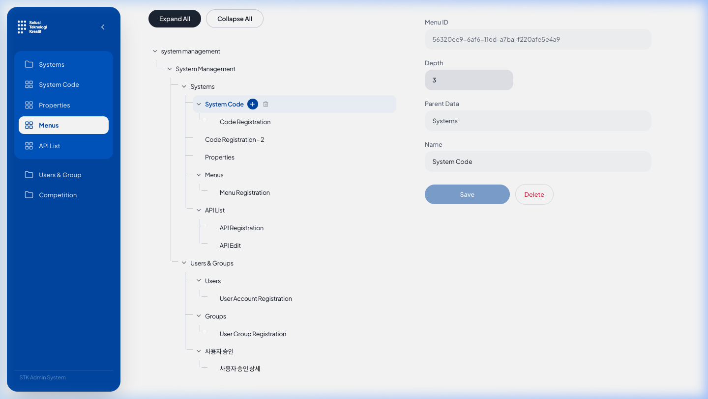
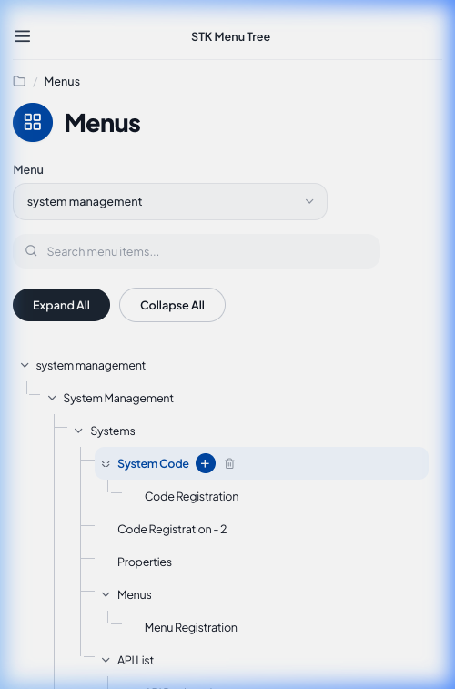
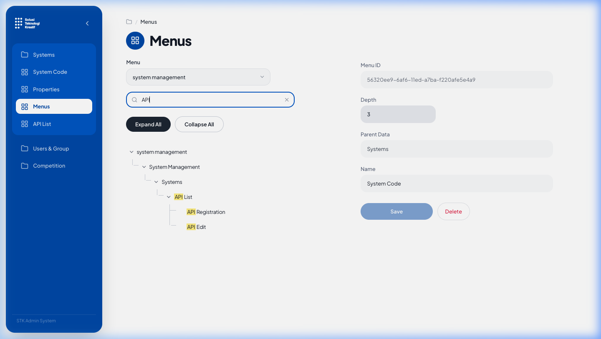
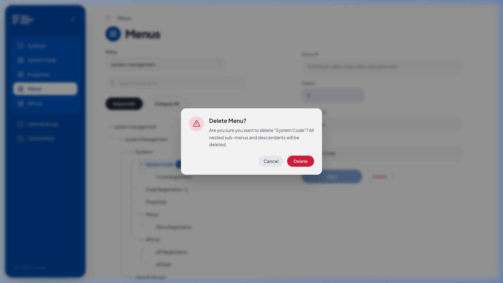

# STK Fullstack Menu Tree System

A production-grade fullstack web application implementing a recursive, unlimited-depth hierarchical menu tree with interactive CRUD operations, drag-and-drop reordering & reparenting, real-time search filtering with ancestor preservation, and pixel-perfect Figma UI fidelity.

Built with **NestJS 10**, **PostgreSQL 16**, **TypeORM**, **Next.js 14 (App Router)**, **Tailwind CSS**, **Zustand**, and **@dnd-kit**.

---

## 📸 Screenshots

| Desktop View (Figma-Aligned Detail Form) | Mobile Responsive Layout |
|:---:|:---:|
|  |  |

| Live Search with Yellow Highlight & Ancestor Auto-Expand | Safe Deletion Confirmation Dialog |
|:---:|:---:|
|  |  |

---

## 🛠 Tech Stack & Architecture Decisions

### 1. Technology Choices
- **Backend (Option A - NestJS 10 & TypeScript)**: NestJS was chosen for its modular architecture, strict dependency injection, built-in validation pipes (`class-validator`), unified exception filters, and automated Swagger OpenAPI generation (`@nestjs/swagger`).
- **Database & Persistence (PostgreSQL 16 + TypeORM)**: Relational integrity with UUID primary keys, foreign key constraints (`ON DELETE CASCADE` for parent-child relations), and native transaction managers for atomic move/reorder workflows.
- **Frontend (Next.js 14 App Router + React 18)**: Server-ready standalone output, clean component boundaries, and high-performance client rendering.
- **Styling (Tailwind CSS)**: Exact Figma token mapping (Primary `#0052AF`, Active/Hover `#0060C9`, Background `#F8FAFC`, `#FFFFFF`, Text `#1D2939`, Borders `#EAECF0`).
- **State Management (Zustand)**: Lightweight, reactive state container handling tree state, expand/collapse sets, search queries, active root selections, and optimistic rollbacks.
- **Drag-and-Drop (@dnd-kit/core & @dnd-kit/sortable)**: Accessible keyboard & pointer sensors with distance constraints (`distance: 8`) to prevent accidental drags on button clicks.

### 2. Architecture Decisions
- **Adjacency List Pattern (`parentId`)**:
  - Simplicity and speed: inserting a node or updating a parent requires updating a single record without mutating entire tree index intervals.
  - Zero schema complexity compared to Nested Sets or Closure Tables.
- **Derived Depth (`depth`)**:
  - `depth` is never stored statically in the database to prevent denormalization anomalies during re-parenting. Depth is computed dynamically on read via ancestor traversal ($O(d)$ where $d \le 10$).
- **$O(n)$ In-Memory Tree Assembly**:
  - The tree is loaded in a single query ordered by `position ASC`, mapped into a lookup dictionary in $O(n)$ time, and built into a hierarchy without redundant $N+1$ recursive queries.
- **Transactional Position Compaction & Cycle Detection**:
  - All move and delete operations execute within a single database transaction. Sibling positions remain contiguous `0..k-1` with no gaps.
  - Client-side and server-side cycle detection guards prevent dropping or moving a node into itself or any of its own descendants ($409\text{ Conflict}$).

### 3. UI Additions Beyond Figma
- **Root Menu Dropdown with `+ New root menu` Action**: Allows creating top-level menus dynamically.
- **Per-Node Quick Action (+)**: Circular blue button on hover/selection to quickly add a child node to that specific parent.
- **Per-Node Delete Trash Action**: Trash button with immediate confirmation modal showing descendant count warning.
- **Real-Time Search Box**: Case-insensitive filtering that keeps all parent ancestors open and highlights matched text in yellow.
- **Expand All / Collapse All**: Toolbar controls to toggle all nested nodes at once.
- **Drag-and-Drop Handle**: Subtle grip indicator (`GripVertical`) for reordering siblings and reparenting.

---

## 📁 Project Structure

```text
stk-menu-tree-fullstack/
├── backend/                        # NestJS 10 API Service
│   ├── src/
│   │   ├── common/                 # Global filters, DTOs (ErrorResponse)
│   │   ├── config/                 # Env validation with Joi/class-validator
│   │   ├── database/               # TypeORM data source, migrations, seed
│   │   ├── health/                 # Health check endpoint (/api/health)
│   │   ├── menus/                  # Entity, DTOs, Controller, Service, Unit Tests
│   │   └── main.ts                 # Bootstrap, Swagger, CORS, ValidationPipe
│   ├── Dockerfile                  # Multi-stage Docker build (deps, dev, build, prod)
│   └── package.json
├── frontend/                       # Next.js 14 App Router UI
│   ├── src/
│   │   ├── app/                    # Layout, font providers, page entrypoint
│   │   ├── components/             # Layout (Sidebar, Header, AppShell), Tree, Form, UI
│   │   ├── lib/                    # API client, tree traversal utilities & tests
│   │   ├── store/                  # Zustand menu store with optimistic updates
│   │   └── types/                  # TypeScript contracts and DTO types
│   ├── Dockerfile                  # Multi-stage standalone Dockerfile
│   └── package.json
├── docs/                           # Figma design references and real app screenshots
│   └── screenshots/
├── docker-compose.yml              # Production compose config (healthchecks, non-root)
├── docker-compose.dev.yml          # Development compose config (hot-reload, bind mounts)
├── .env.example                    # Root environment variables template
└── README.md                       # Comprehensive system documentation
```

---

## ⚡ Prerequisites

- **Node.js**: `v20.x` or higher
- **npm**: `v10.x` or higher
- **PostgreSQL**: `v16.x` (or Docker installed)
- **Docker & Docker Compose** (optional for containerized runs)

---

## 🚀 Setup & Run in Development (Local without Docker)

### 1. Database Setup
Ensure PostgreSQL is running locally on port `5432`:
```bash
# Example user & database setup:
psql -U postgres -c "CREATE USER menu_user WITH PASSWORD 'change_me';"
psql -U postgres -c "CREATE DATABASE menu_db OWNER menu_user;"
```

### 2. Backend Setup
```bash
cd backend
cp .env.example .env
npm install

# Run database migrations
npm run migration:run

# Seed the Figma 19-node hierarchy (including System Code pinned UUID & Korean text)
npm run seed

# Start the NestJS backend in development mode (port 3001)
npm run start:dev
```
Backend will be live at `http://localhost:3001/api`.
Interactive Swagger UI: `http://localhost:3001/api/docs`.

### 3. Frontend Setup
In a new terminal window:
```bash
cd frontend
cp .env.example .env.local
npm install

# Start Next.js development server (port 3000)
npm run dev
```
Open your browser at `http://localhost:3000`.

---

## 📦 Run in Production Mode (Local Build)

### 1. Build & Run Backend
```bash
cd backend
npm run build
npm run start:prod
```

### 2. Build & Run Frontend
```bash
cd frontend
npm run build
npm run start
```

---

## 🐳 Run with Docker

Both production and development configurations are provided with multi-stage caching, healthchecks, and non-root execution.

### Production Mode
```bash
# 1. Copy environment template
cp .env.example .env

# 2. Build and start containers
docker compose up --build
```
- Frontend: `http://localhost:3000`
- Backend API: `http://localhost:3001/api`
- Swagger Docs: `http://localhost:3001/api/docs`
- Healthcheck: `http://localhost:3001/api/health`

### Development Mode (with Live Hot-Reloading)
```bash
docker compose -f docker-compose.dev.yml up --build
```
Edits to `./backend/src` and `./frontend/src` immediately hot-reload inside the containers.

---

## 📖 API Documentation & Swagger

Interactive OpenAPI / Swagger documentation is available at `http://localhost:3001/api/docs`.

### Endpoint Summary

| Method | Endpoint | Description | Status Code |
|:---|:---|:---|:---:|
| `GET` | `/api/health` | Service health status check | `200 OK` |
| `GET` | `/api/menus` | Get full menu tree ordered by position | `200 OK` |
| `GET` | `/api/menus/:id` | Get menu detail with derived depth and parentName | `200 OK` / `404` |
| `POST` | `/api/menus` | Create a new menu (root or child) | `201 Created` / `400` / `404` |
| `PUT` | `/api/menus/:id` | Update menu name | `200 OK` / `400` / `404` |
| `DELETE` | `/api/menus/:id` | Delete menu and all descendants (cascade) | `204 No Content` / `404` |
| `PATCH` | `/api/menus/:id/move` | Reparent menu and/or change position | `200 OK` / `400` / `404` / `409` |
| `PATCH` | `/api/menus/:id/reorder` | Reorder menu among current siblings | `200 OK` / `400` / `404` |

### Example cURL Commands

#### 1. Healthcheck
```bash
curl -X GET http://localhost:3001/api/health
```

#### 2. Get Full Tree
```bash
curl -X GET http://localhost:3001/api/menus
```

#### 3. Create Child Menu
```bash
curl -X POST http://localhost:3001/api/menus \
  -H "Content-Type: application/json" \
  -d '{"name": "Security Audit", "parentId": "56320ee9-6af6-11ed-a7ba-f220afe5e4a9"}'
```

#### 4. Reorder Sibling Position
```bash
curl -X PATCH http://localhost:3001/api/menus/56320ee9-6af6-11ed-a7ba-f220afe5e4a9/reorder \
  -H "Content-Type: application/json" \
  -d '{"position": 1}'
```

#### 5. Move Menu (Reparenting with Cycle Guard)
```bash
curl -X PATCH http://localhost:3001/api/menus/56320ee9-6af6-11ed-a7ba-f220afe5e4a9/move \
  -H "Content-Type: application/json" \
  -d '{"parentId": "ea9cfe54-83b7-435e-a405-455c240c2cdd", "position": 0}'
```

---

## 🗄 Database Schema & Migrations

### Schema DDL
```sql
CREATE EXTENSION IF NOT EXISTS "uuid-ossp";

CREATE TABLE "menus" (
  "id" UUID PRIMARY KEY DEFAULT uuid_generate_v4(),
  "name" VARCHAR(255) NOT NULL,
  "parent_id" UUID REFERENCES "menus"("id") ON DELETE CASCADE,
  "position" INTEGER NOT NULL DEFAULT 0,
  "created_at" TIMESTAMP WITH TIME ZONE NOT NULL DEFAULT now(),
  "updated_at" TIMESTAMP WITH TIME ZONE NOT NULL DEFAULT now()
);

CREATE INDEX "idx_menus_parent_id" ON "menus" ("parent_id");
CREATE INDEX "idx_menus_position" ON "menus" ("position");
```

### Migration Commands
```bash
cd backend

# Run pending migrations
npm run migration:run

# Revert last migration
npm run migration:revert

# Run seeder
npm run seed
```

---

## 🧪 Running Tests & Coverage

### Backend Unit Tests (Jest)
Tests cover `menu-tree.util.ts` (tree construction, orphan handling, cycle detection, depth computation) and `menus.service.ts` (CRUD, move, reorder, transaction rollback, cycle rejection):
```bash
cd backend
npm run test
npm run test:cov
```
> **Backend Coverage**: 36 passed unit tests with ≥ 88% statement coverage on business logic.

### Frontend Unit Tests (Vitest)
Tests cover `tree.ts` (hierarchical search filtering keeping ancestors, case insensitivity, node finding, flattening, and client-side cycle guards):
```bash
cd frontend
npm run test
```
> **Frontend Coverage**: 22 passed unit tests.

---

## 🔍 Known Limitations & Future Improvements

1. **Massive Node Pagination / Virtualization**:
   - The current implementation is optimized for corporate menu navigation trees ($\le 10,000$ items). For millions of nodes, implementing windowed virtualization (`react-window`) and lazy-loading children via on-demand endpoints would further optimize DOM node counts.
2. **Multi-Tenant Scoping**:
   - Menu trees are currently scoped per root node. Adding a `tenant_id` or `organization_id` column would support enterprise multi-tenancy.
3. **Role-Based Access Control (RBAC)**:
   - Adding permission tags per menu item (e.g. `roles: ['ADMIN', 'MANAGER']`) so non-admin users only view authorized subtrees.
